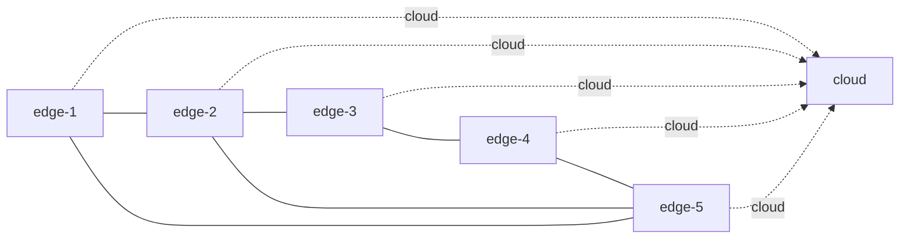

# One-shot: campagna controllata con cinque edge eterogenei e un cloud

Data: 2026-10-10. Stato: progetto aggiornato; implementazione native autorizzata dall’utente dopo completamento della progettazione, gate scientifici obbligatori.

## Obiettivo e ambito

Misurare baseline locale+cloud, one-shot ORACLE e one-shot EWMA su Multipass con cinque edge, un cloud distinto, risorse e tempi di servizio differenti, traffico verso tutte le sei VM e condizioni che esercitino offload orizzontale e verticale. La prova precedente resta una verifica tecnologica dei workflow. Questa campagna deve permettere confronti quantitativi ripetuti, con validità circoscritta all'ambiente locale controllato.

Il requisito dell'utente è l'eterogeneità dei nodi, non un cambiamento del problema computazionale a seconda del nodo che riceve una richiesta. Pertanto si usa inizialmente una sola funzione Rust, con identici immagine, input e checksum su tutti i nodi. Tempi diversi si ottengono tramite quote CPU diverse per replica, e si misurano realmente. Aumentare i vCPU della VM non è, da solo, una garanzia di un tempo di servizio diverso.

Alternative considerate: ampliare soltanto il preset attuale non risolve profili omogenei e rete completa; riscrivere protocollo/solver aumenterebbe inutilmente l'ambito. La soluzione scelta estende orchestrazione, calibrazione e analisi NanoLab e riusa i contratti e il protocollo nativi NanoFaaS. Azure, altri algoritmi, PG, nuovi workload e guasti durante la campagna principale restano fuori ambito.

## Logging edge come prerequisito

Applicare la [specifica logging comune](2026-10-10-edge-logging-design.md) e il [piano dedicato](../plans/2026-10-10-edge-logging.md): tutti i moduli e SDK emettono il contratto comune, Fluent Bit per VM, Loki/Grafana su host con budget esplicito. Prima della calibrazione misurare overhead in tre coppie logging-off/on e congelare stack, formato/livello, limiti e configurazioni nei fingerprint. Goodput/p95 devono rientrare nel gate iniziale 5%; altrimenti revisionare il budget e ripetere le prove. Il carico e i completamenti restano contabilizzati da evidence SDK/metriche, non dai log. Export per run e metriche collector precedono cleanup con receipt hash e completezza dichiarata.

## Risorse proposte

Dimensioni iniziali, da confermare nel preflight dell'esecuzione; nessuna assegnazione viene effettuata scrivendo questi documenti.

| Nodo | vCPU VM | RAM VM GiB | CPU per replica | Massimo repliche | Pool repliche MiB |
| --- | ---: | ---: | ---: | ---: | ---: |
| edge-1 | 1 | 2 | 0.35 | 1 | 256 |
| edge-2 | 1 | 3 | 0.50 | 1 | 256 |
| edge-3 | 2 | 3 | 0.60 | 2 | 512 |
| edge-4 | 2 | 4 | 0.70 | 2 | 512 |
| edge-5 | 3 | 6 | 0.85 | 2 | 512 |
| cloud | 8 | 12 | 1.00 | 7 | 1792 |

Totale: 17 vCPU e 30 GiB. Ogni replica usa 256 MiB, concorrenza fisica uno, stesso input CPU-bound verificabile: `iterations=20000000`, `working_set_bytes=4096`, `seed=7`. Il pool è un limite del solver, distinto dalla RAM totale della VM; `maxReplicas * cpuQuota <= vCPU` lascia spazio al runtime. Il cloud deve mantenere almeno il 10% di margine sulla capacità fisica validata rispetto a **tutto** il traffico previsto, inclusa la sua quota diretta: conservare il controllo prudenziale esistente, usando il suo profilo locale.

L'host osservato ha 20 CPU logiche e circa 122 GiB di RAM: la tabella è plausibile ma non autorizza overcommit. Il preflight deve includere risorse di VM preesistenti, generatore, control plane, collector da 0.10 CPU/64 MiB e 256 MiB disco per nodo, backend Loki/Grafana e host; se manca margine interrompe prima del provisioning. Non arrestare VM estranee. Registrare contesa, guest steal quando disponibile, CPU/pressione host e limiti effettivi dei container. Tutte le VM restano sullo stesso host: nessuna conclusione sulla diversità di hardware fisico o sulla WAN.

## Topologia e rete

Grafo edge con archi bidirezionali: `1–2`, `2–3`, `3–4`, `4–5`, `5–1`, `2–5`. Non è una rete completa: i gradi sono 2, 3, 2, 2, 3. Ogni edge può raggiungere direttamente il cloud. Le richieste inoltrate a un peer restano terminali, senza secondo hop.

Usare l'attuale file operatore P2P: peer consentiti `FORCE_ACTIVE`, altri edge `EXCLUDED`, file generato prima dell'avvio e montato nel control plane. I seed sono bootstrap, non una restrizione della topologia. Membership gossip e vicini operativi sono distinti: verificare l'insieme esatto di `activeNeighbors` e degli endpoint one-shot su ogni edge, all'avvio e durante la campagna. Registrare identità/incarnazioni, non soltanto il numero dei peer. La prima campagna usa rete `observed-local`, misurando RTT e banda; non aggiunge emulazione WAN o firewall sperimentali.

## Profili per nodo e compatibilità

NanoLab oggi aggrega campioni di tutti i nodi in un profilo per funzione e rifiuta differenze di servizio; il baseline usa limiti globali. Correggere questi presupposti nel workflow, senza rilassare le tolleranze.

Pubblicare sei profili NanoFaaS v1 separati, ciascuno con servizio `D[node,function]`, quote, pool/intervallo di repliche, campioni e fingerprint del nodo misurato. Un nuovo indice **NanoLab**, `artifactType: node-profile-set`, contiene riferimenti relativi e SHA-256 dei sei profili, del riepilogo delle capacità misurate, fingerprint della campagna e binding degli ID dei nodi. Non modificare lo schema pubblico NanoFaaS v1 per introdurre un profilo globale eterogeneo.

Il riferimento `oneShot.profile` può identificare l'indice; il reader normalizza il vecchio profilo singolo soltanto per configurazioni omogenee. Nessuna migrazione silenziosa di vecchi profili. La configurazione locale del runtime riceve solo il proprio profilo; qualificazione e manifest congelano l'hash dell'indice e ogni riferimento. Cambiare grafo, limiti, immagine, input o ambiente richiede nuova calibrazione e qualificazione.

La calibrazione verifica ogni numero ammesso di repliche e anche la contesa quando tutti i nodi eseguono insieme. Rifiutare intervalli in cui il modello di capacità lineare non regge. Misurare inoltre `C[node]`, capacità fisica sostenibile con il massimo delle repliche dichiarate: è la base della traccia, separata dal limite prudenziale `r * U / D` del solver. Non calibrare `D` dalla latenza client e non gonfiare il numero di repliche oltre CPU/RAM verificate.

## Carico e protocollo congelati

Generatore open-loop k6 esterno alle sei VM, con ID originali, nessun retry applicativo e prova della puntualità degli arrivi. Ogni finestra dirige carico positivo a tutti i cinque edge. Il cloud riceve anche un carico diretto fisso del 5% di `C[cloud]`, contabilizzato separatamente dall'offload verticale; non esegue aste e non inoltra richieste.

Traccia iniziale a fasi, sei epoche per fase:

1. Controllo: ogni edge a `0.35 * C[node]`.
2. Cinque fasi hotspot: ciascun edge, a turno, a `1.8 * C[node]`; gli altri a `0.35 * C[node]`. L'ordine degli hotspot è deterministico dal seed, identico tra modalità.
3. Due hotspot adiacenti: edge-1/edge-2 a `1.8 * C[node]`, altri a `0.35 * C[node]`.
4. Sovraccarico diffuso: tutti gli edge a `1.10 * C[node]`.
5. Recupero: tutti gli edge a `0.35 * C[node]`.

Totale 54 epoche per modalità. Quantizzare esplicitamente sulla griglia `q`, salvando tassi richiesti/tassi effettivi: arrotondare verso l'alto per sovraccarico e verso il basso per fondo, garantendo fondo positivo e quantità rappresentabili. Il periodo viene dalla nuova qualificazione, non dal precedente `T=20s`. Il pilot conferma che i moltiplicatori producono saturazione effettiva e che il cloud non è il collo di bottiglia; altrimenti pubblicare una nuova versione del disegno e rifare i prerequisiti.

Qualificare le effettive celle della traccia, compreso il carico cloud, con almeno 50 campioni completi per cella, quantile 0.95, margine asta 0.2s, margine readiness 0.3s, `epsilon=0.05`, candidati periodo `[5,10,20,30,60]` secondi, risoluzione massima 60s e zero censura. Anticipo sufficiente alla readiness misurata; non riusare automaticamente i vecchi timeout. Congelare bounds di protocollo prima di ciascuna qualificazione; tentativi falliti restano nel dossier. Controllare il vettore dei tassi per nodo/funzione, non solo la somma globale.

Il pilot deve dimostrare almeno un completamento peer e uno edge→cloud nei modi one-shot, con saturazione misurata e generatori sani. È un gate di copertura del pilot, non una regola che censura gli esiti della campagna: zero offload o prestazioni peggiori nella campagna principale rimangono risultati osservati. Il baseline ha zero offload orizzontale per definizione.

## Disegno statistico e metriche

Unità sperimentale: una ripetizione indipendente dell'intera traccia, eseguita nei tre modi su topologie ricreate. Le richieste nella stessa ripetizione non sono repliche statistiche indipendenti. Usare stessi input, quote, pool, rete e trace hash fra i modi, ordine dei modi bilanciato sulle sei permutazioni e seed registrati. I budget statici del baseline sono quelli di ciascun nodo; le differenze native di coda restano esplicite.

Prima un pilot di sei triplette, una per permutazione, escluso dall'inferenza principale. Contrasto primario: EWMA meno baseline nella quota di originali edge completati nel cloud, denominatore **originali edge pianificati**, nelle ultime quattro epoche di ogni fase. Condizione complementare: quota di completamento EWMA non inferiore di oltre 2 punti percentuali; riportare separatamente errori ed esiti irrisolti. ORACLE è un confronto secondario, non dichiarato un upper bound matematico dell'algoritmo.

Obiettivo iniziale di precisione/dimensionamento: rilevare una differenza di 5 punti percentuali, potenza pianificata 0.8 e livello bilaterale 0.05. Dalla deviazione standard `s` delle differenze appaiate del pilot stimare `ceil(((1.959964+0.841621)*s/0.05)^2)`, minimo 12, arrotondato al multiplo successivo di sei. Se richiede oltre 36 ripetizioni, interrompere e presentare budget/disegno revisionati, senza troncare il numero e dichiarare ugualmente la potenza. È un'approssimazione di pianificazione, non una garanzia; l'incertezza del pilot va dichiarata. Congelare numerosità e analisi prima della campagna; niente arresto appena il risultato appare favorevole.

Intervalli al 95% mediante bootstrap appaiato di **intere ripetizioni**, 10.000 ricampionamenti, seed congelato. Riportare anche ogni valore individuale e differenza appaiata. Metriche: originali pianificati/emessi, completamenti/errori/censura, goodput, latenza p50/p95/p99 e timeout, local/peer/cloud per origine e destinazione, matrice dei flussi, utilizzo/concorrenza/repliche/code, preparazione/asta/readiness e relativo overhead. Cloud diretto, transizioni e prime due epoche delle fasi sono visibili separatamente; conservare tutti i dati grezzi. Goodput, quote e utilità del confronto edge escludono gli originali cloud diretti; il riepilogo di tutta la piattaforma li include con un'etichetta separata, senza contarli due volte come locale e offload.

Nessuna selezione dei run in base al risultato algoritmico. Un'invalidità tecnica rende invalida l'intera tripletta, che resta pubblicata; i rimpiazzi usano seed successivi prestabiliti, limite massimo 20% del numero pianificato. Superato il limite la campagna è incompleta, senza conclusione confermativa. Il sottoinsieme valido e i motivi di esclusione sono sempre espliciti. Rimpiazzare solo invalidità esterne identificate: problemi dipendenti dal modo, readiness/asta fallite e cause ambigue restano risultati operativi, non esclusioni neutrali; in questi casi l'inferenza primaria è inconcludente. Il bootstrap assume indipendenza fra blocchi: riportare l'ordine temporale, controllare drift/correlazione seriale dei contrasti, e rinunciare alla conclusione confermativa se l'assunzione non è sostenibile. Quantificare l'effetto prima di usare la parola «significativo».

Principi metodologici: [NIST, scelta del disegno](https://www.itl.nist.gov/div898/handbook/pri/section3/pri3.htm), [NIST, randomized block designs](https://www.itl.nist.gov/div898/handbook/pri/section3/pri332.htm). Blocchi e randomizzazione controllano variazioni estranee; la numerosità delle VM non sostituisce la replicazione.

## Accettazione e autorizzazione

- Grafo operativo esatto, sei VM eterogenee e profili per nodo validati.
- Ogni origine edge e il cloud ricevono traffico; fondo cloud distinto dall'offload.
- Pilot esercita saturazione, offload orizzontale e verticale con prove SDK reali.
- Qualificazione indipendente copre la traccia; generatore, host e cloud hanno margine.
- Campagna ripetuta con metriche e analisi congelate, errori ed esclusioni visibili.
- Cleanup di risorse possedute verificato su successo e failure, senza toccare risorse estranee.
- Nessun claim Azure/WAN, nessuna conclusione garantita in anticipo.

L’utente ha successivamente autorizzato l’implementazione native dopo il completamento della progettazione. I gate logging, calibrazione, qualificazione e pilot precedono la campagna principale; merge/push non inclusi.
